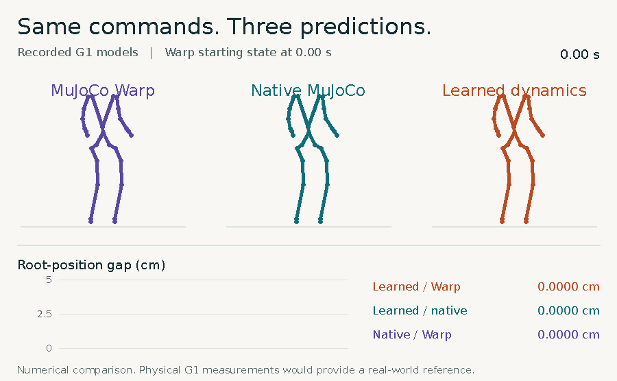

# SuperMimic × MuJoCo

A closer look at how learned dynamics can train a robot controller, and how that differs from physics simulation, imagined experience and model-based planning.

**[Explore the comparison](https://ajaycyril.github.io/supermimicdemo/)** · **[Read the article](https://ajaycyril.github.io/supermimicdemo/article.html)**

## Recorded Warp comparison

The deployed demo includes a three-way replay from MuJoCo Warp 3.16.0 on CPU, native MuJoCo WASM, and the community model. For its scripted probe, the learned model's median one-second gap was 6.06 cm against Warp and 6.08 cm against native MuJoCo. The two physics backends had a median gap of 0.00020 cm. These figures use five overlapping rollout windows from one trajectory.

## The live browser experiment

Across 128 overlapping prediction windows from eight seeded MuJoCo trajectories, the community world model's median root-position gap against native MuJoCo WASM was 0.12 cm at 20 ms, 3.75 cm at 500 ms and 8.12 cm at one second. The 56 windows starting with a root height above 0.6 m showed the same broad increase.

These are measurements of prediction disagreement in a limited scripted experiment. The trajectories include falls. This is not a balance-policy evaluation, a training-speed benchmark, or a claim that SuperMimic outperforms SONIC.

## Explore

The browser comparison runs MuJoCo and the released neural dynamics model locally. Adjust motion, frequency, friction, command noise and state refresh while it runs. Pause, advance one step, slow the view to 0.1×, or replay a recorded trajectory. Recordings retain the applied control changes.

The [article](article/article.md) compares SuperMimic with SONIC and differentiable physics, explains the role of MuJoCo Warp, and describes how to use matched Warp rollouts and hardware measurements to resolve the observed disagreements.

[Study data](article/horizon-study.json) · [Methodology](docs/METHOD.md) · [Study implementation](tools/benchmark.mjs)

## Sources

The pretrained dynamics checkpoint comes from [CuboiLeo's independent reproduction](https://github.com/CuboiLeo/SuperMimic-Reproduced). The original research is [SuperMimic](https://supermimic.github.io/); the earlier controller comparison is [SONIC](https://nvlabs.github.io/GEAR-SONIC/).

The project uses [mjlab](https://github.com/mujocolab/mjlab) robot parameters, [MuJoCo](https://github.com/google-deepmind/mujoco), [ONNX Runtime](https://github.com/microsoft/onnxruntime), and [gifenc](https://github.com/mattdesl/gifenc). Source notices and model provenance are retained with the project.

By Ajay Cyril · [DigDeepTech](https://digdeeptech.com/)
