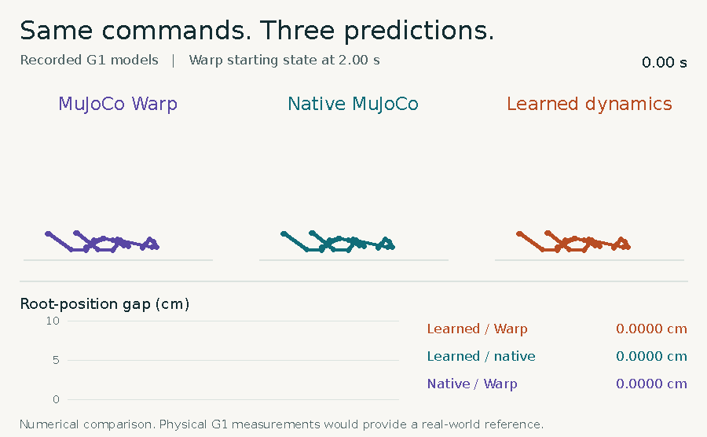

# When SuperMimic and MuJoCo disagree, which one is right?

*What I learned about using a world model to train a humanoid, and what it would take to trust its predictions.*

I clicked on SuperMimic because a humanoid controller had reached a strong tracking score in three hours on one GPU. Then I put a learned model and MuJoCo side by side in my browser. I gave them the same commands, watched their trajectories separate, and realized I'd built a demo that could easily suggest a conclusion I hadn't tested. If the orange robot lands differently from the teal one, which landing should I believe?

I can measure exactly how far apart they land. To answer which is closer to reality, I'd need a third trajectory.

## The part that got me interested

Imagine a Unitree G1 landing a jump and pitching forward. Its policy turns observations and a motion target into motor commands. A model-free method such as PPO can learn from many landings by scoring the outcomes. SuperMimic can also ask how a small change to an earlier command would affect the predicted landing. That sensitivity is a gradient.

The world model predicts a few steps ahead. The optimizer works backward from the tracking objective through those predictions to the policy that chose the commands. If the model thinks a small change in hip torque would improve the landing, the optimizer can use that information to update the policy. The model stays fixed during that policy update. Its weights are fitted separately using simulator transitions. [SuperMimic paper](https://arxiv.org/abs/2610.28480)

*This schematic shows where the gradient flows. The browser runs forward predictions.*

## Why use a world model when you already have Warp?

SuperMimic **already uses MuJoCo Warp** to generate the physics transitions its world model learns from. MuJoCo Warp is the GPU implementation of MuJoCo. It can run many physics environments in parallel. The learned model gives the authors a second way to generate short trajectories, with a differentiable path back to the policy. The project reports over 10× rollout throughput relative to MuJoCo Warp at its training batch sizes on an H100. That measures throughput for the reported setup. [SuperMimic results](https://supermimic.github.io/) · [MuJoCo Warp](https://github.com/google-deepmind/mujoco_warp)

| Training approach | Where the experience comes from | How the policy learns |
| --- | --- | --- |
| SONIC | Physics simulation | PPO estimates policy updates from sampled outcomes |
| SuperMimic | MuJoCo Warp transitions and short learned rollouts | Backpropagation through learned dynamics |
| ∇Mimic | A specialized differentiable physics simulator | Backpropagation through the physics solver |

The SuperMimic team reports beating the released SONIC checkpoint's tracking return after three hours on one H100. SONIC's reported training ran for seven days on 128 L40 GPUs, with different hardware and more motion data. The benchmark motions were training motions for both, so the failure counts measure coverage of known motions. In a more targeted ablation, SuperMimic reached PPO's best training return using about 64 times fewer imagined steps when both methods used the same learned model. That's evidence that the gradient path helped in that experiment. [SuperMimic results](https://supermimic.github.io/) · [SONIC](https://nvlabs.github.io/GEAR-SONIC/)

Physics solvers can provide gradients too. MuJoCo Warp's current documentation lists differentiation as unavailable. ∇Mimic, a separate project, uses its own differentiable solver and reports reaching SuperMimic's published LAFAN1 tracking score in roughly 20 minutes versus 1.2 hours. That comparison uses separately reported runs on different GPUs. The ∇Mimic result covers simulated G1 tracking on flat ground. It gives me a reason to compare differentiable physics directly when asking which training approach works best. [MuJoCo Warp compatibility](https://github.com/google-deepmind/mujoco_warp#user-content-mujoco-api-compatibility) · [∇Mimic paper](https://arxiv.org/abs/2610.41654)

*The engine that generates a trajectory and the method that updates the policy are separate choices.*

## What my demo actually runs

The [browser demo](https://ajaycyril.github.io/supermimicdemo/) steps native MuJoCo compiled to WebAssembly on one side. On the other, ONNX Runtime runs weights exported from CuboiLeo's independent SuperMimic reproduction. The robots start in the same state and take the same scripted joint commands, with the same selected foot friction. The visual uses computed body poses. The live comparison uses scripted commands. The Warp comparison below replays a separate recorded experiment. [Checkpoint and code](https://github.com/CuboiLeo/SuperMimic-Reproduced) · [Demo method](https://github.com/ajaycyril/supermimicdemo/blob/main/docs/METHOD.md)

Try **One step** to start each learned prediction from the current MuJoCo state. Every 20 ms the model gets a fresh starting point. In **Free rollout**, it has to use the state it predicted on the previous step. That lets a small mismatch affect every step that follows.

*In 128 overlapping windows from eight scripted trajectories, the median root-position gap grew from 0.12 cm at 20 ms to 8.12 cm at one second. The windows include falls and share trajectories. The GIF records a comparison with native MuJoCo.*

## What changed when I ran MuJoCo Warp?

I ran MuJoCo Warp 3.16.0 on CPU and captured a scripted G1 trajectory. I then started the native browser engine and the learned checkpoint from states on that trajectory and replayed the same commands. All three use the same joint and root starting state. The two physics engines use the same adapted G1 XML. This setup lets me measure the native–Warp gap directly, although it still differs from the reproduction's full training environment.

*Recorded body positions and root-position gaps starting from the initial pose. Playback is slowed.*

| Pair of predictions | Median gap at 20 ms | Median gap at 1 s |
| --- | --- | --- |
| Learned model and MuJoCo Warp | 0.122 cm | 6.06 cm |
| Learned model and native MuJoCo | 0.122 cm | 6.08 cm |
| Native MuJoCo and MuJoCo Warp | <0.00001 cm | 0.00020 cm |

The one-step column uses 150 predictions refreshed from one Warp trajectory. The one-second column uses five overlapping free rollouts from that same trajectory. On this probe the learned model was similarly far from both physics engines, while their median gap was tiny by comparison. That weakens the explanation that the learned model diverged mainly because I chose native MuJoCo. Other contact conditions and simulator settings could change the result.

*The same comparison from the lowest starting pose in the recorded set. Compare the shape of the three gap curves during contact.*

A position gap is symmetric. Either prediction can be closer to the behavior of a physical G1. Trajectories and measured gaps tell me what the engines did. A measured robot trajectory tells me what happened.

## What would settle the disagreement?

| Question | Evidence I'd use |
| --- | --- |
| Did the learned model reproduce the simulator it learned from? | Replay held-out starts and actions in the exact training Warp setup, starting with one-step predictions and extending across contacts. Replay the same inputs in native MuJoCo to measure backend and configuration differences. |
| Would its advice improve the controller? | Ask the learned model for a small action or policy update. Evaluate that update in Warp on held-out motions, next to a matched update made without its gradient. Check reward and falls across seeds. |
| Which prediction is closer to a real G1? | Record time-aligned G1 state and executed commands on a measured floor across repeated, safe trials. Start both engines from the measured state and compare each to the held-out hardware trace using joint, base and foot-contact errors. |

The second test matters because two curves can pass near the same point and still have very different slopes. A model that predicts a plausible landing could still tell the optimizer to push harder in the wrong direction. The third test matters because even the exact training simulator models friction, actuator behavior and contact. The original paper's real-G1 demonstrations give evidence that its **policy transfers** on the motions shown. To decide which dynamics prediction was closer during a specific landing, I'd still want synchronized measurements of that landing. [Real Unitree G1 demonstrations](https://supermimic.github.io/)

I started this project thinking about how quickly you could simulate a robot. Now the question I want to test is whether a small change suggested by the world model improves the **next landing outside the model**. The browser demo gives me a way to see where the predictions begin to split. The recorded Warp comparison checks how much my choice of simulator explains for this probe. Hardware would answer the separate question of physical accuracy.

[Run the comparison](https://ajaycyril.github.io/supermimicdemo/) · [Download the article with GIFs and data](https://github.com/ajaycyril/supermimicdemo/tree/main/article)
