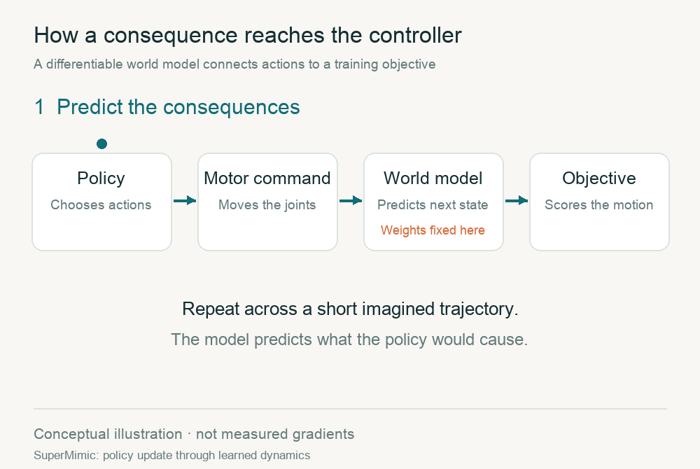

# SuperMimic: why the gradient matters

*How learned world models change robot training, where physics simulators still fit, and how SuperMimic connects to Dreamer, SHAC and other approaches.*

I first looked at SuperMimic because of the GPU headline. A humanoid controller reaching a strong tracking result in hours on one GPU, after earlier work used a large cluster, was enough to get my attention.

Then I watched the explanation about a world model “passing the gradient back.” That seemed more interesting than the speed comparison. What information was travelling backwards? Why couldn't a physics simulator provide it? And was this a new idea, or a new application of an existing one?

The question I now find useful is: **what does a model let the robot learn from the consequences of an action?** A prediction tells us what might happen. A derivative can also tell an optimizer how a small change might alter that outcome.

## A bad landing, and two ways to learn from it

A robot's **policy** converts observations and a movement target into motor commands. Suppose the robot is trying to land a jump and finishes leaning too far forward.

One route is to try many variations, score their outcomes and update the policy so actions associated with better results become more likely. PPO, used in SONIC's controller training, follows this general route. It computes a policy gradient from sampled experience; it does not need to differentiate through the simulator's dynamics.

A second route asks a more local question: if an earlier command changed slightly, how would the predicted landing error change?

That sensitivity is a **gradient**. It is a direction for a small adjustment, not an explanation in words and not a promise that a large adjustment will work. To use it across several moments of a movement, the training system links the derivatives through those moments using the chain rule.

A differentiable world model supplies that link. The optimizer can work backwards from an objective, through predicted states and actions, to the policy parameters that produced those actions.

*An explanatory schematic. Predictions move forward; derivatives connect the objective back to the policy. The arrows do not represent a measured SuperMimic run.*

## What SuperMimic does with that path

SuperMimic learns a dynamics model from MuJoCo Warp transitions and uses it for short imagined rollouts. The policy improves through backpropagation across those rollouts, with a critic estimating value beyond the prediction window. The model is shared across the motion library rather than relearning a separate physics model for each movement. [SuperMimic method](https://arxiv.org/pdf/2610.28480).

There are two different learning steps here. When fitting the world model, its predictions are compared with simulator transitions and its own weights change. During a policy update, the model's weights are held fixed, but derivatives still pass through its calculations to the policy. “Frozen weights” does not mean “no gradient through the inputs.”

Think of a fixed calculator. You can ask how its output changes when you change an input without changing the calculator itself. The policy update uses that sensitivity; the next model-fitting phase can improve the calculator.

This also separates training from deployment. In this approach, the world model helps train the controller. The deployed controller can then choose commands from observations and goals without running an imagined search at every step.

## A world model and a physics simulator are not opposites

In this setting, a learned dynamics model is itself a kind of simulator. The difference is how it produces the next state.

A conventional physics engine computes motion from a specified system: masses, geometry, joints, forces and contact rules. A learned model approximates transitions from data. That data might come from a physics engine or from a physical robot.

Here, “world model” also does not mean a video generator. It can predict numerical robot states or a compact internal representation used for decisions. A model need not render a realistic scene to be useful for control.

| Question | Physics simulator | Learned dynamics model |
| --- | --- | --- |
| Where does its behavior come from? | Equations, parameters and numerical solvers | A fitted approximation to observed transitions |
| What can go wrong? | Inaccurate physical parameters, contact assumptions and numerical effects | Missing data, prediction bias and unfamiliar states |
| Can it provide derivatives? | Some simulators can | A differentiable network can provide derivatives of its approximation |
| Why use it? | Structured dynamics and controlled experimentation | Efficient prediction, adaptation from data, and potentially a useful gradient path |

MuJoCo Warp accelerates physics calculations on NVIDIA GPUs. That is a different question from whether the policy optimizer uses derivatives through those calculations. mjlab supplies robotics environments and training infrastructure around the physics engine.

The statement “only the world model passes the gradient back” describes the comparison in SuperMimic's presentation. It is not a statement that physics simulators can never be differentiated. [SHAC](https://short-horizon-actor-critic.github.io/) is a useful counterexample: it uses differentiable simulation, short learning windows and a critic to train policies. Contacts, long derivative chains and numerical instability make that route challenging.

## Two choices that separate the approaches

I found it easier to compare methods by asking two questions: **what generates the forward trajectory, and what supplies the policy's learning signal?**

| Approach | Forward experience | How the policy improves |
| --- | --- | --- |
| SONIC / PPO | Physics simulation | Policy-gradient estimates from scored experience |
| SHAC | Differentiable physics simulation | Derivatives through the simulator |
| DMO | Physics simulation | Derivatives through a learned dynamics model |
| Robotic World Model (RWM) | Learned neural simulation | PPO using imagined experience |
| SuperMimic | Learned dynamics | Derivatives through the learned dynamics |

[DMO](https://proceedings.mlr.press/v305/amigo25a.html) is a particularly interesting middle ground. It uses simulator trajectories for the forward pass, but a learned model for the backward pass. This reduces the problem of a learned prediction drifting further from the simulator at each forward step, while still providing a derivative when simulator gradients are unavailable. It retains the cost of generating simulator experience.

[RWM](https://arxiv.org/html/2501.10100v1) makes a different point: a world model can serve as a neural training environment while PPO remains the policy optimizer. **Using a world model does not automatically mean backpropagating through its dynamics to train the policy.** That distinction is easy to lose when every approach is described as learning “in imagination.”

*The forward engine and the feedback route are separate design choices. Both illustrated systems learn a control policy.*

## Where Dreamer and planning fit

The original [Dreamer](https://danijar.com/project/dreamer/) is a close conceptual relative. It learns from images, imagines trajectories in a compact latent space, and trains behavior using analytic gradients through those trajectories. This makes it clear that differentiating through learned dynamics predates SuperMimic.

The family also shows why version names matter. [DreamerV3](https://arxiv.org/pdf/2301.04104) learns an actor and critic from imagined trajectories, but its published actor update uses a REINFORCE estimator for both discrete and continuous actions. A learned world model and a direct dynamics-gradient policy update should not be treated as the same thing.

[TD-MPC2](https://www.tdmpc2.com/) uses a learned latent model for local trajectory optimization. It highlights another use for a world model: planning actions at decision time. That differs from using imagined rollouts primarily to improve a policy during training.

[DayDreamer](https://danijar.com/project/daydreamer/) explores the source of the experience. It learns world models and behaviors directly on physical robots, without relying on a physics simulator for its experiments. That is a different proposition from learning a fast approximation of simulator dynamics and then transferring a controller to hardware.

These approaches occupy different parts of the same design space: learn from simulation or reality; represent physical state or latent state; train a policy or plan actions; use sampled returns or derivatives through dynamics. There is no single architecture hidden behind the phrase “world model.”

## What makes the SuperMimic result interesting

SuperMimic brings these ideas to large-scale humanoid motion tracking and demonstrates a deployed controller. It reports exceeding the released SONIC checkpoint's tracking return after three hours on one H100, compared with SONIC's reported seven days on 128 L40 GPUs. Hardware and training data differ, so that headline is not a matched hardware comparison. [Project results](https://supermimic.github.io/).

SONIC also includes a shared motion representation and interfaces for different goal inputs. The comparison concerns tracking and training efficiency, not every capability of that broader system. [SONIC](https://nvlabs.github.io/GEAR-SONIC/).

The evaluation motions also come from the training set, so those scores measure coverage rather than unseen-motion generalization. And the reported greater-than-10× rollout throughput over MuJoCo Warp uses large GPU batches on an H100. It does not predict the speed of one simulation in a Mac browser.

For the gradient question, the more revealing experiment is the paper's comparison with PPO inside the same world model. It reports reaching PPO's best return with about 64 times fewer imagined steps in that setup. That comparison helps separate the learning signal from the advantage of a faster forward model. It is not a universal speedup for every robot or objective. [Analysis in the paper](https://arxiv.org/pdf/2610.28480).

## The catch: a useful prediction is not necessarily a useful derivative

A learned model may predict the next state reasonably well and still have the wrong local sensitivity to an action. Two curves can pass close to the same point while having different slopes there. An optimizer follows the slope.

This is why prediction accuracy, derivative quality and final control performance are three different things to evaluate. A policy might exploit an error in its learned environment. A long prediction might drift. A smooth approximation might give a convenient gradient while misrepresenting a contact event.

My browser experiment investigates only the prediction part. Using [CuboiLeo's community reproduction](https://github.com/CuboiLeo/SuperMimic-Reproduced), I compared the learned model with MuJoCo over 128 overlapping windows from eight seeded, scripted trajectories. Both received the same saved commands.

*Median root-position error rose from 0.12 cm at 20 ms to 8.12 cm at one second. Whiskers show the 10th–90th percentile. These trajectories include falls; this is not a balance-policy evaluation.*

That makes error accumulation visible. It does not measure the quality of SuperMimic's policy gradients or reproduce its training result. The checkpoint is an independent reproduction, and the test uses native MuJoCo WASM rather than the training Warp backend. [Measurements and methodology](https://github.com/ajaycyril/supermimicdemo/blob/main/docs/METHOD.md).

The next experiment I would trust would check whether an action change suggested by the learned model actually improves the objective when evaluated in the simulator. I would repeat that across states, contacts and held-out motions, rather than judge the idea from two robots falling together.

## What this suggests for robotics

World models give us several ways to reuse experience: generate more training examples, evaluate possible actions, estimate consequences, or provide derivatives that guide learning. SuperMimic is interesting because of the particular combination it uses, not because it invented all of those ingredients.

I now read a world-model result by asking where the experience came from, what the model predicts, how its predictions influence decisions, and where those decisions are checked. That makes the comparison much more concrete than “AI physics versus real physics.”

For robotics, the practical question is whether the model helps produce better decisions with the available data and compute, and whether those decisions survive contact with the system we actually care about.

[Explore the prediction comparison](https://ajaycyril.github.io/supermimicdemo/) · [Code and measurements](https://github.com/ajaycyril/supermimicdemo)
