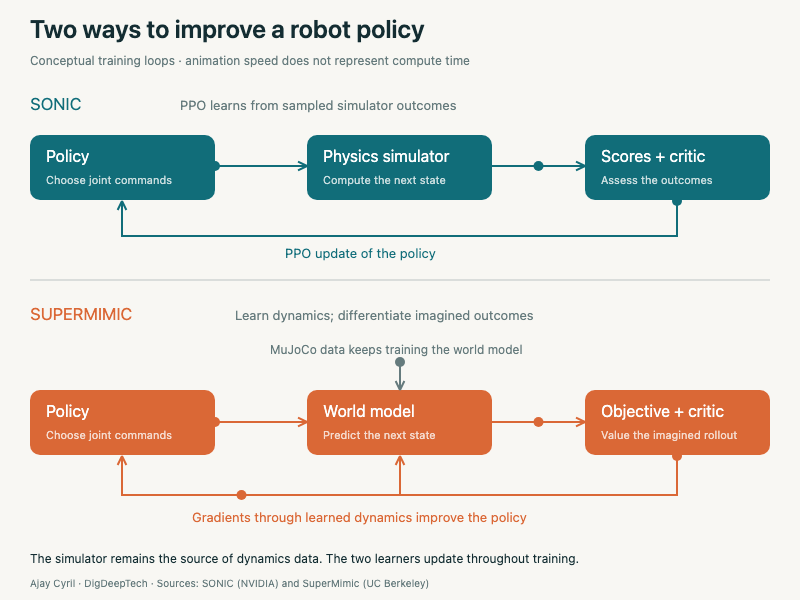
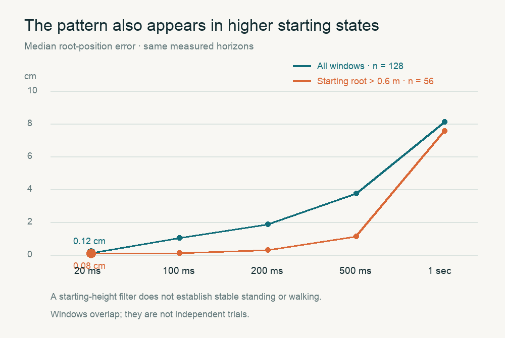

# Why SuperMimic learns through a model of physics

*What changed since SONIC, why an imperfect world model can be useful, and what I learned by testing its predictions.*

A post about humanoid training caught my attention: a week on 128 GPUs, followed by a wave of results on a single GPU. I followed it to SuperMimic. The robot videos were impressive, but one question stayed with me: **if we already have a physics simulator, why train another model to predict physics?**

The answer is about how a controller learns from consequences. SuperMimic uses a learned model to make those consequences cheaper to predict and easier to differentiate through. It still needs the simulator.

I built a browser experiment to investigate one part of that idea: how prediction error changes as the model looks further ahead. It does not reproduce the training-speed claim.

## First, what is learning?

A robot controller, or **policy**, takes the robot's current observations and a movement target, then produces motor commands. Its problem is choosing actions that lead to a good result a few moments later.

Imagine a robot missing a landing. The final error is easy to see. Working out which earlier motor commands should change is harder.

[SONIC](https://nvlabs.github.io/GEAR-SONIC/) trains its controller with PPO. The controller tries actions in a simulator, receives rewards, and is updated using those sampled outcomes. PPO uses gradients to update the policy, but it does not need a gradient through the simulator's physics calculations.

SONIC also solves a broader interface problem: robot motions, human poses and teleoperation inputs are encoded into a shared, quantized motion representation. A control decoder combines that representation with the robot's observations. The wider system includes motion planning and interfaces to VR and vision-language-action models. Calling it simply the expensive old baseline misses much of the work. [SONIC paper](https://arxiv.org/html/2511.07820v4).

## SuperMimic changes the feedback path

A **world model** answers a different question from the policy: given this state and this action, what state comes next?

SuperMimic collects examples from MuJoCo Warp and learns that transition. It then lets the policy act through short sequences of predicted states. Because those predictions are differentiable, the training objective can send a gradient back through the sequence to the policy.

That is what “passing the gradient back” means. It calculates how changing an earlier decision would change a later objective, according to the learned model. It does not mean reversing the robot's movement.

*Conceptual training loops. The animation illustrates the feedback paths; it is not a timing measurement.*

The simulator remains the source of dynamics experience. The world model and policy keep being updated during training; the model is held fixed during an individual policy update. SuperMimic also uses a critic to estimate value beyond the short rollout. It is not asking one imperfect prediction to stay correct indefinitely. [SuperMimic paper](https://arxiv.org/pdf/2610.28480).

## Why the approximation can be useful

A neural dynamics model can evaluate many transitions efficiently on a GPU. More unusually, it gives policy optimization a differentiable route through the predicted consequences of actions.

Those are two separate benefits: **more efficient prediction** and **a different learning signal**. Neither requires the model to replace a physics simulator for every purpose.

But approximation has a cost. If a prediction is wrong, the next prediction starts from that wrong state. The resulting gradient is also a gradient of the learned model, not a guarantee about the real world. Differentiability does not automatically mean accurate advice.

That trade-off was the part I could make concrete on my Mac.

## My experiment: how far ahead stays useful?

I used the released dynamics checkpoint from [CuboiLeo's independent SuperMimic reproduction](https://github.com/CuboiLeo/SuperMimic-Reproduced), alongside MuJoCo running in the browser. This is a community model, not the official SuperMimic checkpoint.

For each prediction window, I copied a state from MuJoCo into the world model. Both then received the same saved motor commands. I measured the distance between their root positions after 20, 100, 200, 500 and 1,000 milliseconds, without refreshing the predicted state inside that window.

I repeated this over **128 overlapping windows from eight seeded trajectories**. The motor script moved the shoulders with a small amount of repeatable command noise. These are related samples from a limited setup, not 128 independent tests of general robot behavior.

*Measured root-position error against MuJoCo. Bars show the median; whiskers span the 10th to 90th percentile across the 128 windows.*

| Prediction horizon | Median position error | 90th percentile |
| --- | --- | --- |
| 20 ms | 0.12 cm | 0.20 cm |
| 100 ms | 1.02 cm | 1.26 cm |
| 200 ms | 1.86 cm | 2.77 cm |
| 500 ms | 3.75 cm | 7.80 cm |
| 1 second | 8.12 cm | 14.39 cm |

The model was much closer over a single step than over a full second. That is the useful observation here: a good next-state prediction does not imply an equally good long rollout.

The trajectories include falls. Two falling robots, by themselves, prove very little: neither is being driven by a trained balance policy in this experiment. The measurement is their prediction disagreement, not their ability to stand.

I therefore also checked the 56 windows whose starting root height was above 0.6 metres. Their median error rose from 0.08 cm at 20 ms to 7.55 cm at one second. That does not make them a benchmark of stable walking, but it shows that the overall pattern is not confined to windows starting near the ground.

*Median errors for all 128 windows and the 56-window higher-root subset. A high starting root does not guarantee the robot remains standing during the prediction.*

This supports a narrow conclusion about this checkpoint and these states: **prediction horizon matters**. It does not prove that the model's gradients improve a policy, that it matches physical reality, or that it beats SONIC. Those require different experiments. [Measurements and method](https://github.com/ajaycyril/supermimicdemo/blob/main/article/horizon-study.json).

## What the headline numbers do and do not say

SuperMimic reports exceeding the released SONIC checkpoint's tracking return after **three hours on one H100**, compared with SONIC's reported seven-day run on 128 L40 GPUs. Three hours is not the three-minute number circulating in the broader wave of robotics posts. The hardware and training data also differ. [Project and results](https://supermimic.github.io/).

The reported world-model rollout speedup over MuJoCo Warp uses an H100 and thousands of parallel environments. It is a throughput measurement under that setup, not a promise that a single browser simulation will run ten times faster.

The paper's more controlled PPO comparison and its world-model policy-update ablation are more useful for understanding the mechanism than the headline alone. They help separate the benefits of the training method from the broad comparison with SONIC. [Experiments in the paper](https://arxiv.org/pdf/2610.28480).

MuJoCo Warp is GPU-accelerated physics. mjlab provides robotics environments and training infrastructure around it. My browser uses native MuJoCo WebAssembly, so even the prediction study includes a possible difference between the training and test simulator backends.

## What I took away

The interesting idea is that a model can be useful for learning without being a perfect long-term simulator. SuperMimic combines simulated experience, a learned transition model, short rollouts and policy optimization. The simulator and world model have different jobs in that loop.

My experiment made the limitation visible: extending a prediction horizon can turn a small discrepancy into a much larger one. It also clarified what I have not tested. Accurate state prediction and useful policy gradients are related questions, but they are not the same measurement.

The next comparison I would trust would use states from a trained motion-tracking policy, include held-out movements, and evaluate whether changes suggested by the learned model actually improve outcomes in the simulator. That would connect prediction accuracy to the question that matters for control: does the robot make better decisions?

[Explore the comparison](https://ajaycyril.github.io/supermimicdemo/) · [Code and measurements](https://github.com/ajaycyril/supermimicdemo) · [SuperMimic](https://supermimic.github.io/) · [SONIC](https://nvlabs.github.io/GEAR-SONIC/)
