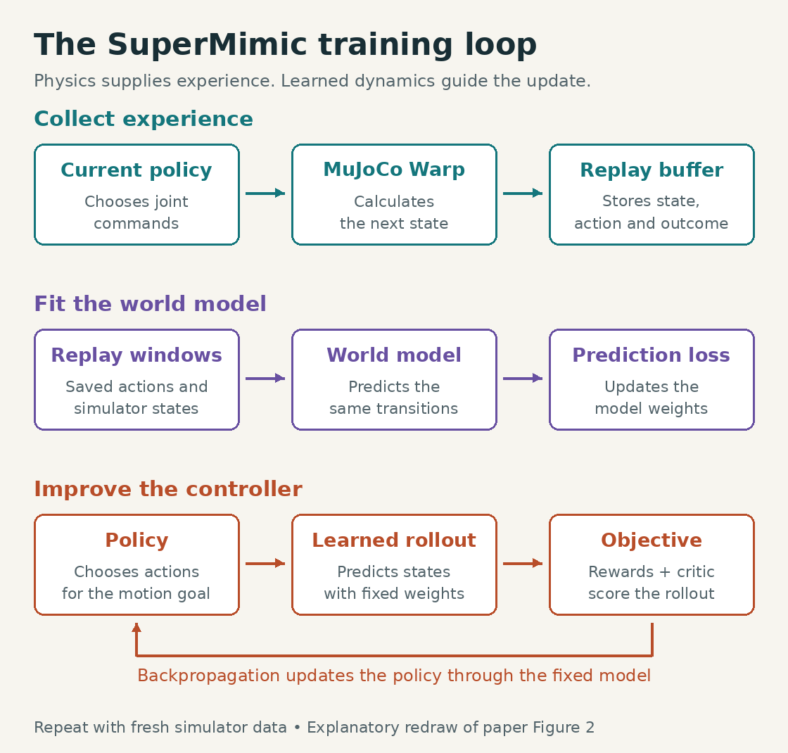
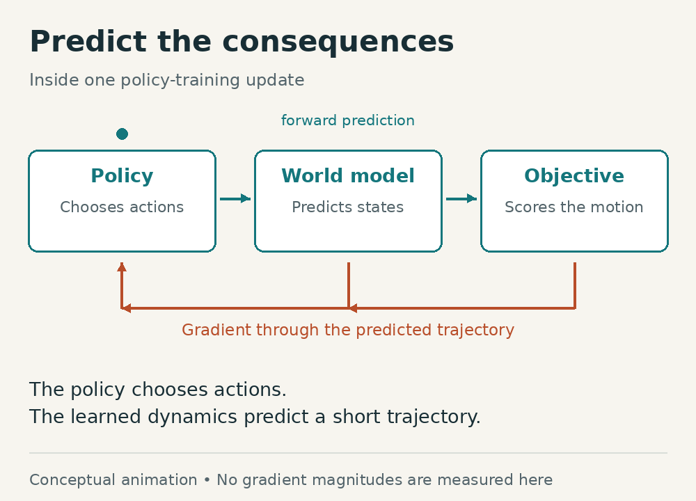
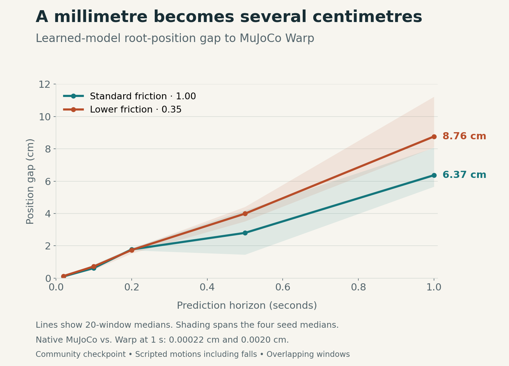

# One GPU, three hours. How SuperMimic makes robots learn faster.

*What happens when a humanoid can learn from the consequences it predicts? Inside the architecture, the headline result, and my experiment with MuJoCo.*

I saw the SuperMimic result and immediately wanted to know what had changed.

The researchers report exceeding the tracking return of SONIC’s released controller after **three hours on one H100 GPU**. SONIC’s reported training used **128 L40 GPUs for seven days**. The GPUs and training datasets differ, which matters when interpreting that comparison. Even with that qualification, it is a result worth opening the paper for. [SuperMimic project and reported comparison](https://supermimic.github.io/)

What caught my attention was the training mechanism. The team learns a model of how the robot moves, then uses that model to improve the controller. A prediction becomes a route for learning.

I built a small experiment to understand that distinction. It also forced me to confront a question that the impressive videos leave open. When the learned model and the physics simulator disagree, which one should I trust?

[Try my interactive experiment](https://ajaycyril.github.io/supermimicdemo/) · [Explore the code and measurements](https://github.com/ajaycyril/supermimicdemo)

## A backflip is also a credit-assignment problem

Picture a robot attempting a backflip. It jumps, rotates, lands, and pitches forward.

The training system can give that attempt a score. But which earlier decision deserves the blame? The take-off posture? The timing of the legs? An ankle command just before contact?

This is the problem hiding inside the robot video. A controller needs to learn how its earlier actions affect a later outcome.

The controller, usually called a **policy**, maps observations and a movement goal to motor commands. A physics simulator lets it try those commands, experience the consequences and collect a reward. A method such as PPO uses sampled outcomes to estimate how the policy should change.

SuperMimic opens another route. A differentiable model can estimate how a small change to an action would change the predicted outcome. The optimizer can follow that sensitivity backward through several steps and into the policy’s parameters.

That sensitivity is a **gradient**. You can think of it as a local answer to “which way should I adjust this command?”

## SONIC made scale work. SuperMimic changes how training uses it.

SONIC is an important reference because it demonstrated how scaling motion data, controller capacity and compute could produce a broadly capable humanoid controller. Its shared representation connects motion tracking with teleoperation, planning and higher-level interfaces. That broader system deserves credit when discussing a comparison of tracking scores. [SONIC project, architecture and demonstrations](https://nvlabs.github.io/GEAR-SONIC/)

A motion library can contain walking, crouching, dancing and jumping. The goals change across those clips, while the robot’s joints, mass and contact dynamics provide shared structure.

Learning a model of that structure creates an opportunity to reuse experience. Once the model has learned something about how this robot responds to a command, that knowledge can help train many movements.

That is the idea I found most compelling in SuperMimic. The world model is shared across the motion library, and model fitting and controller improvement happen together. [SuperMimic paper, §3](https://arxiv.org/pdf/2610.28480)

## The architecture has two learners and a physics engine

Here is the training loop I wanted to understand.

*My schematic of the training loop in Figure 2 of the paper. The world model and the controller are trained in different phases of the same repeating loop.*

**Collect experience.** The current controller acts in MuJoCo Warp. Those transitions go into a replay buffer.

**Fit the world model.** The network learns to predict short sequences from those stored transitions.

**Improve the controller.** Starting from recorded states, the controller produces actions inside the learned model. A short predicted trajectory supplies rewards, and a critic estimates value beyond its end. Backpropagation updates the controller while the world-model weights are held fixed. The loop then collects fresh simulator experience. [SuperMimic paper, Figure 2 and §3.1–3.3](https://arxiv.org/pdf/2610.28480)

“World model” can sound like something that generates a movie. Here it predicts robot dynamics from numerical state, action and simulator context, including friction. Its role is practical. It supplies a next-state prediction and a differentiable path through that prediction.

Freezing the model during a policy update is easy to misunderstand. A fixed function still has a slope. You can differentiate its output with respect to its input without changing the function’s own parameters.

*An explanatory animation. The forward pass predicts consequences. The backward pass tells the optimizer how changing the policy would affect its predicted score.*

The distinction also helps explain deployment. The trained controller chooses actions on the robot. The learned environment does its work during training. [SuperMimic paper, §4.4](https://arxiv.org/pdf/2610.28480)

## Why learn physics when MuJoCo already does physics?

Because “produce the next state” and “provide a useful training signal” are different requirements.

A conventional physics engine calculates motion from specified geometry, masses, forces, actuator behavior and contact rules. Its output depends on those assumptions and on a numerical solver.

A neural dynamics model fits transitions from examples. Its predictions depend on the data it saw and the approximation it learned. A differentiable network also gives you derivatives through its calculations.

Imagine changing a knee command slightly. Both engines can be run again to see what happens. With a differentiable model, the optimizer can calculate sensitivities through the predicted trajectory directly. Whether those sensitivities improve the real task is something to test.

**MuJoCo Warp is already part of SuperMimic’s training loop.** It accelerates MuJoCo physics on NVIDIA hardware. Warp’s programming tools support differentiation, but MuJoCo Warp’s current README lists differentiation through that simulator as unavailable. Being built with an autodiff-capable framework does not automatically make an entire solver ready for this kind of policy training. [MuJoCo Warp documentation](https://github.com/google-deepmind/mujoco_warp)

Differentiable physics is a serious alternative. SHAC demonstrated policy learning through simulator gradients using short windows and a critic. Contact changes and unstable gradients make the engineering difficult, and that work tackles those difficulties directly. Learned dynamics and differentiable physics are two ways to obtain a gradient through predicted motion. [SHAC project and paper](https://short-horizon-actor-critic.github.io/)

There is history behind learned imagination too. The original Dreamer trained behavior through trajectories predicted by a learned model. That connection helps place SuperMimic in a longer research direction. [Dreamer](https://danijar.com/project/dreamer/)

## Why the result is impressive

The headline combines several advantages. The project reports learned rollouts over **10× faster than MuJoCo Warp** at its practical training batch sizes on an H100. In a separate ablation, differentiating through the world model reached PPO’s best training return with about **64× fewer imagined steps**, with both using world-model rollouts. Those figures come from different experiments and should be read separately. [SuperMimic analysis](https://supermimic.github.io/)

For me, the second comparison makes the architectural point especially well. A faster environment lets you collect more experience. A more informative update can help you learn more from the experience you already have.

The project also reports controller transfer to a physical Unitree G1. Its large motion benchmark uses training motions, so the reported failure counts describe coverage of that library. The hardware demonstrations provide another kind of evidence about the resulting controller. [SuperMimic results and real-robot demonstrations](https://supermimic.github.io/)

My interpretation is that lower training cost could change how teams work. More ideas can be tried, more failures can be investigated, and more experiments can fit into a research budget. The practical value depends on how well those gains survive a new robot, task or operating condition.

## I tested the prediction. Here is where it drifted.

I used a checkpoint from CuboiLeo’s independent reproduction and compared its predictions with MuJoCo Warp and native MuJoCo. Both physics engines used the same adapted G1 model. The commands were scripted, and every prediction window began from the same recorded state. [Community reproduction](https://github.com/CuboiLeo/SuperMimic-Reproduced)

*My experiment, using four seeds and five overlapping windows per seed at each friction setting. Points show median root-position gaps. These are measurements from the community checkpoint and demo configuration.*

The median gap to Warp started at about a millimetre. After one second it reached **6.37 cm** at standard friction and **8.76 cm** at lower friction. At the same horizon, the median native-MuJoCo-to-Warp gaps were **0.00022 cm** and **0.0020 cm**.

For this probe, changing the MuJoCo backend explained little of the learned model’s divergence. Lower friction also produced a larger one-second median gap for each of the four seeds. It changed the trajectory and the states encountered, so that result belongs to this complete experimental setup.

The trajectories include falls, the windows overlap, and the solver occasionally reached its configured iteration limits. This small experiment measures agreement with a simulator. It gives us a concrete view of drift while leaving controller quality and real-world fidelity for separate tests. [Interactive results](https://ajaycyril.github.io/supermimicdemo/) · [Full method and limitations](https://github.com/ajaycyril/supermimicdemo/blob/main/docs/METHOD.md)

## Which one would I choose?

I would choose based on the job.

| Job | What I would use or compare |
| --- | --- |
| Generate reference transitions under a specified physical model | A physics simulator with calibrated robot and contact parameters |
| Train this kind of humanoid tracker efficiently | Compare learned-model training with a strong simulator-based baseline on matched compute and data |
| Obtain gradients through movement | Compare learned dynamics and differentiable physics, including how their updates perform in the reference environment |
| Predict a physical robot accurately | Evaluate both against held-out, time-aligned hardware measurements |

There is an extra catch with a learned model. Two predictions can be close while their local slopes differ. A small state error does not guarantee a helpful gradient. An optimizer may also discover actions that exploit a model’s mistakes.

My next experiment would therefore ask for a small policy update through the learned model, then check whether it improves tracking when evaluated in Warp across held-out motions and seeds. A hardware trace would answer the further question of which dynamics prediction follows the actual robot more closely.

I came to SuperMimic for the one-GPU headline. I stayed for the idea that a prediction can do more than describe a possible future. It can tell a training system how to change the decisions that produced it.

That is the part I want to test next.

[Open the demo](https://ajaycyril.github.io/supermimicdemo/) · [Get the code](https://github.com/ajaycyril/supermimicdemo) · [Read the original research](https://supermimic.github.io/)

*Credit to Qiayuan Liao and the SuperMimic team, the SONIC authors, and CuboiLeo for the independent reproduction used in my experiment. The diagrams are my explanatory redraws. The measurements are from my published demo.*
