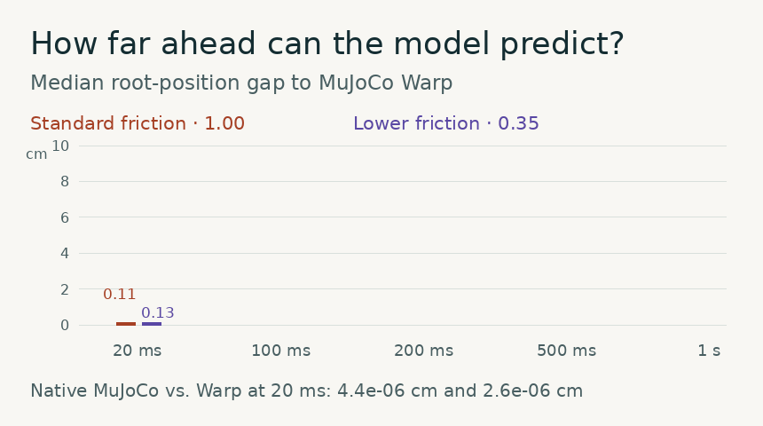

# When SuperMimic and MuJoCo disagree, which one is right?

*What I learned about using a world model to train a humanoid, and what it would take to trust its predictions.*

I clicked on SuperMimic because a humanoid controller had reached a strong tracking score in three hours on one GPU. Then I put a learned model and MuJoCo side by side in my browser. I gave them the same commands, watched their trajectories separate, and realized I'd built a demo that could easily suggest a conclusion I hadn't tested. If the orange robot lands differently from the teal one, which landing should I believe?

I can measure exactly how far apart they land. To answer which is closer to reality, I'd need a third trajectory.

## The part that got me interested

Imagine a Unitree G1 landing a jump and pitching forward. Its policy turns observations and a motion target into motor commands. A model-free method such as PPO can learn from many landings by scoring the outcomes. SuperMimic can also ask how a small change to an earlier command would affect the predicted landing. That sensitivity is a gradient.

The world model predicts a few steps ahead. The optimizer works backward from the tracking objective through those predictions to the policy that chose the commands. If the model thinks a small change in hip torque would improve the landing, the optimizer can use that information to update the policy. The model stays fixed during that policy update. Its weights are fitted separately using simulator transitions. [SuperMimic paper](https://arxiv.org/abs/2610.28480)

## Why use a world model when you already have Warp?

SuperMimic **already uses MuJoCo Warp** to generate the physics transitions its world model learns from. MuJoCo Warp is the GPU implementation of MuJoCo. It can run many physics environments in parallel. The learned model gives the authors a second way to generate short trajectories, with a differentiable path back to the policy. The project reports over 10× rollout throughput relative to MuJoCo Warp at its training batch sizes on an H100. That measures throughput for the reported setup. [SuperMimic results](https://supermimic.github.io/) · [MuJoCo Warp](https://github.com/google-deepmind/mujoco_warp)

| Training approach | Where the experience comes from | How the policy learns |
| --- | --- | --- |
| SONIC | Physics simulation | PPO estimates policy updates from sampled outcomes |
| SuperMimic | MuJoCo Warp transitions and short learned rollouts | Backpropagation through learned dynamics |
| ∇Mimic | A specialized differentiable physics simulator | Backpropagation through the physics solver |

The SuperMimic team reports beating the released SONIC checkpoint's tracking return after three hours on one H100. SONIC's reported training ran for seven days on 128 L40 GPUs, with different hardware and more motion data. The benchmark motions were training motions for both, so the failure counts measure coverage of known motions. In a more targeted ablation, SuperMimic reached PPO's best training return using about 64 times fewer imagined steps when both methods used the same learned model. That's evidence that the gradient path helped in that experiment. [SuperMimic results](https://supermimic.github.io/) · [SONIC](https://nvlabs.github.io/GEAR-SONIC/)

Physics solvers can provide gradients too. MuJoCo Warp's current documentation lists differentiation as unavailable. ∇Mimic, a separate project, uses its own differentiable solver and reports reaching SuperMimic's published LAFAN1 tracking score in roughly 20 minutes versus 1.2 hours. That comparison uses separately reported runs on different GPUs. The ∇Mimic result covers simulated G1 tracking on flat ground. It gives me a reason to compare differentiable physics directly when asking which training approach works best. [MuJoCo Warp compatibility](https://github.com/google-deepmind/mujoco_warp#user-content-mujoco-api-compatibility) · [∇Mimic paper](https://arxiv.org/abs/2610.41654)

## What changes when I ask it to predict further ahead?

I picked a narrower question for the [browser experiment](https://ajaycyril.github.io/supermimicdemo/). If I start all three models from the same state and give them the same commands, does the learned prediction stay close to Warp? And how much of the gap could come from choosing a different MuJoCo backend?

I used the same G1 geometry and motor settings for both physics engines. Each comparison starts from a recorded Warp pose and velocity. Native MuJoCo and the learned model then predict forward without a reset. I tried four seeds at two friction settings, with five starting points per trajectory. Lower friction is a setting I supply to all three engines. The commands come from a script, so a fall here tells us little about the quality of a trained controller.

*Each bar is the median of 20 overlapping prediction windows at its friction setting. The animation advances the look-ahead time. The bottom line reports how much the two physics engines differed at that horizon.*

| Foot friction | Learned ↔ Warp at 20 ms | Learned ↔ Warp at 1 s | Native ↔ Warp at 1 s |
| --- | --- | --- | --- |
| Standard, 1.00 | 0.105 cm | 6.37 cm | 0.00022 cm |
| Lower, 0.35 | 0.131 cm | 8.76 cm | 0.0020 cm |

Three things stood out. At one step the median learned-to-Warp gap was about a millimetre. At one second the gap was several centimetres. The two physics engines stayed much closer in this setup, so the choice of MuJoCo backend explains little of the gap. The median one-second gap was also larger on the lower-friction setting for each of the four seeds. Changing friction changes the motion and the states encountered, so I'd treat that as a result for this script and floor setup.

The checkpoint is from [CuboiLeo's independent reproduction](https://github.com/CuboiLeo/SuperMimic-Reproduced). I ran MuJoCo Warp 3.16.0 on CPU with the demo's G1 model. The site replays those captures and offers a separate live native-MuJoCo comparison. The runs used an adapted configuration, and Warp occasionally reached the configured solver iteration limits. [Method and reproducibility](https://github.com/ajaycyril/supermimicdemo/blob/main/docs/METHOD.md)

## What would settle the disagreement?

| Question | Evidence I'd use |
| --- | --- |
| Did the learned model reproduce the simulator it learned from? | Replay held-out starts and actions in the exact training Warp setup, starting with one-step predictions and extending across contacts. Replay the same inputs in native MuJoCo to measure backend and configuration differences. |
| Would its advice improve the controller? | Ask the learned model for a small action or policy update. Evaluate that update in Warp on held-out motions, next to a matched update made without its gradient. Check reward and falls across seeds. |
| Which prediction is closer to a real G1? | Record time-aligned G1 state and executed commands on a measured floor across repeated, safe trials. Start both engines from the measured state and compare each to the held-out hardware trace using joint, base and foot-contact errors. |

The second test matters because two curves can pass near the same point and still have very different slopes. A model that predicts a plausible landing could still tell the optimizer to push harder in the wrong direction. The third test matters because even the exact training simulator models friction, actuator behavior and contact. The original paper's real-G1 demonstrations give evidence that its **policy transfers** on the motions shown. To decide which dynamics prediction was closer during a specific landing, I'd still want synchronized measurements of that landing. [Real Unitree G1 demonstrations](https://supermimic.github.io/)

I started this project thinking about how quickly you could simulate a robot. Now the question I want to test is whether a small change suggested by the world model improves the **next landing outside the model**. The browser demo gives me a way to see where the predictions begin to split. The recorded Warp comparison checks how much my choice of simulator explains for this probe. Hardware would answer the separate question of physical accuracy.

[Run the comparison](https://ajaycyril.github.io/supermimicdemo/) · [Download the article with GIFs and data](https://github.com/ajaycyril/supermimicdemo/tree/main/article)
