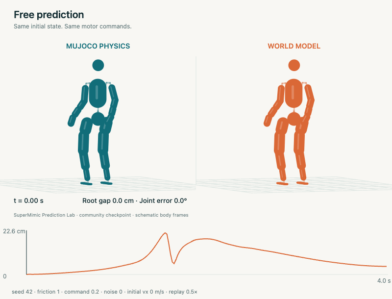
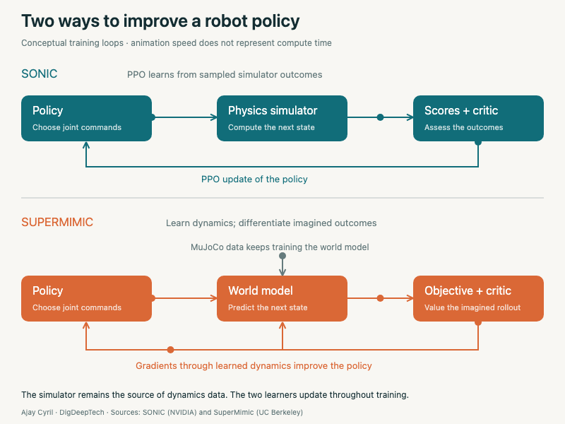
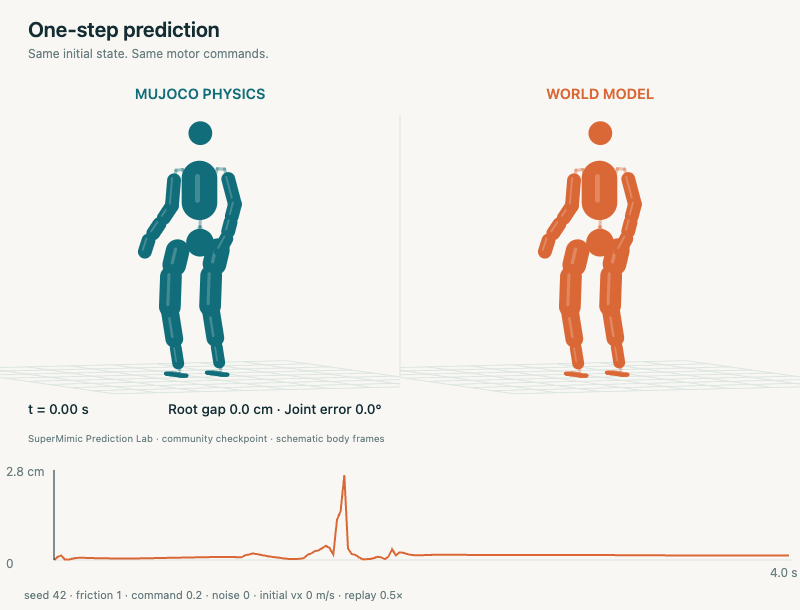
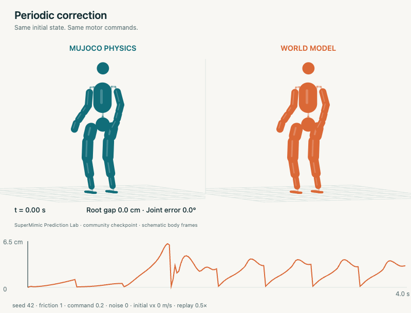
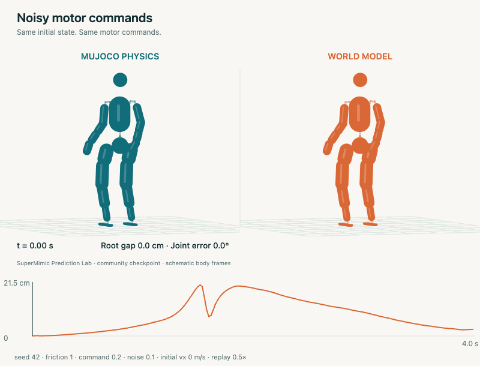

# I tried SuperMimic to understand why robot training is getting faster

*What changed since SONIC, why a world model helps, and what I could actually test in a browser.*

A post about humanoid training stopped me scrolling. The comparison was striking: a week on 128 GPUs, followed by a new wave of results on a single GPU.

I followed it to [SuperMimic](https://supermimic.github.io/). The robot videos were impressive. But the part I wanted to understand was underneath them: why would learning a model of physics help when we already have physics simulators?

I ended up building a small browser demo to make that question visible. It puts a learned world model next to MuJoCo, gives both the same commands, and measures where they disagree.

*My experiment, using a released community checkpoint. Teal is MuJoCo; orange is the world model. The chart measures their root-position gap. This is a scripted movement, not a trained tracking policy.*

## First, the headline needs its footnotes

SuperMimic reports **three hours on one H100** to exceed the released SONIC checkpoint’s tracking return. The comparison is with SONIC’s reported seven-day training run on 128 L40 GPUs. SuperMimic’s three hours include simulator data collection, world-model fitting and policy updates; checkpoint evaluation is excluded. That is different from saying an entire humanoid controller now universally trains in three minutes. [Source: SuperMimic project and compute accounting](https://supermimic.github.io/).

The improvement is interesting enough without combining the best numbers from different projects into one claim.

## What SONIC was doing

[NVIDIA’s SONIC](https://nvlabs.github.io/GEAR-SONIC/) made a strong case for scaling motion tracking: train one controller on a large, varied motion library, rather than making a separate controller for every movement.

Its architecture also tackles a practical problem. A motion might come from robot joint targets, a human pose, or a teleoperation setup. SONIC has encoders that translate these inputs into a shared, quantized motion representation. A control decoder combines that representation with the robot’s observations to produce joint commands. Its broader system includes a kinematic planner and connections to VR and vision-language-action models.

The controller learns with PPO, a reinforcement-learning method that improves decisions using the outcomes of sampled simulator experience. SONIC’s training uses Isaac Lab. It is more than a slow baseline with a large GPU bill. [Source: SONIC paper, sections 3.2 and 3.3](https://arxiv.org/html/2511.07820v4).

## The distinction that made SuperMimic click for me

A **policy** asks: given what is happening, what should the robot do?

A **world model** asks: if the robot does that, what happens next?

A **simulator** answers the second question by computing dynamics and contacts from a physics description. A learned world model approximates the answer from experience.

SuperMimic keeps the simulator. It collects transitions from MuJoCo Warp, fits a differentiable dynamics model, and improves the policy through short imagined rollouts. The policy and world model keep updating within the training loop. The model is held fixed only during an individual policy update. [Source: SuperMimic method](https://arxiv.org/pdf/2610.28480).

*An explanatory animation, not measured execution or a speed comparison. Both methods train a policy; the route used to improve it differs.*

“Passing the gradient back” means calculating how earlier decisions affect the training objective, through the learned model’s calculations. That signal helps adjust the policy. It does not mean the robot moves backwards, and PPO is not “gradient-free”: its policy update estimates a gradient without differentiating through the simulator’s dynamics.

| Question | SONIC | SuperMimic |
| --- | --- | --- |
| What produces joint commands? | A motion-conditioned control policy | A motion-conditioned control policy |
| Main route for policy improvement | PPO from simulator experience | Gradients through learned dynamics |
| What is the emphasis? | Scalable tracking and a broad motion interface | Making tracking-policy training more efficient |
| What remains essential? | Motion data, simulator, objectives and evaluation | Motion data, simulator, objectives and evaluation |

## Why use a world model if the simulator already works?

A learned approximation can be useful in two ways: it can produce many predicted transitions efficiently, and it can expose a differentiable path from a later outcome back to an earlier action.

That is a different argument from “neural networks understand physics better.” An approximate model can be useful for optimization without being a universal replacement for a simulator.

There is also a catch built into the idea. A policy can be improved using predictions that are wrong. An error in one predicted state can affect the next prediction. I wanted to see that accumulation rather than just read about it.

*Fresh MuJoCo state before every 20 ms prediction. This isolates short-horizon disagreement.*

## My small experiment

The demo runs real MuJoCo as WebAssembly, alongside the dynamics network from [CuboiLeo’s independent SuperMimic reproduction](https://github.com/CuboiLeo/SuperMimic-Reproduced). I exported the released weights for ONNX Runtime Web and checked its outputs against an independent evaluation of the original weights.

My contribution is the browser comparison, controls, measurement and capture workflow. The research and pretrained weights belong to their authors. This is not the official SuperMimic checkpoint.

For the first test I deliberately use a repeatable joint-command script. Both engines start from the same robot state and receive exactly the same commands. That keeps a change in decision-making out of this particular comparison.

Then I let the world model feed its own output into its next prediction. This sequence is a rollout. Finally, I try refreshing its state from MuJoCo every half second.

*The model weights do not change. Each refresh gives the next prediction a better starting point.*

Here is what the four-second run showed:

| Prediction setup | Largest root gap | Gap at four seconds |
| --- | --- | --- |
| Fresh state every step | 2.8 cm | 0.15 cm |
| Free prediction | 22.6 cm | 4.4 cm |
| Refresh every half second | 6.5 cm | 3.2 cm |

Same seed, same friction, same command script. All three runs completed. The larger gap earlier in the motion would disappear if I showed only the final number, which is why the demo keeps the whole curve.

This is evidence about one experiment. It does not reproduce SuperMimic’s training improvement or benchmark SONIC’s policy.

## The claims I would be careful with

**The benchmark matters.** The reported 179, 25 and zero failed motions are simulator results on a shared training-motion set. They measure coverage under that protocol, not generalization to every unfamiliar movement. Zero failures belongs to the longer 9.8-hour, two-GPU run. [Source: reported evaluation protocol](https://supermimic.github.io/).

**The comparison is not fully matched.** Hardware and training data differ. The paper also includes a more controlled PPO comparison on LAFAN1 and an ablation of policy updates inside the same world model. Those are useful evidence for the mechanism, beyond the headline comparison with SONIC. [Source: SuperMimic, Figures 4 and 5](https://arxiv.org/pdf/2610.28480).

**Rollout speed is not total training speed.** The world-model-versus-Warp throughput result uses an H100 and thousands of parallel environments. My single-environment browser timings answer a different question. MuJoCo Warp uses NVIDIA GPUs; mjlab supplies the environment and training structure around it. Neither is running as a CUDA workload on my Mac.

**A learned simulator still inherits a simulator gap.** SuperMimic learns its dynamics from simulated transitions. Physical-robot demonstrations are valuable, but they do not establish that its model predicts every real contact or disturbance accurately.

**My falling robot needs context too.** A simple motor script is not a learned balance policy. A fall in this demo is not evidence that SuperMimic’s trained controller cannot balance.

## What I tried next, and what I still want to test

*Friction falls from 1.0 to 0.3. The model is explicitly told the friction value; it does not discover the floor material from vision.*

*Both engines receive the same seeded command noise. Changing the inputs does not retrain the model.*

*The same initial forward velocity, then independent predictions. This is not a continuous external push.*

The next experiments I would take seriously are more demanding: repeat across many initial states and seeds; sweep prediction horizon; test dynamics settings outside the training range; and add a trained policy with a properly licensed reference motion. For a policy comparison, SONIC and SuperMimic would need matched observations, motion inputs, robot parameters and failure criteria.

I would also separate two questions: how accurately does the model predict, and how successfully does the controller perform? A good score on one does not automatically answer the other.

That is what I found most useful about building this. The impressive video becomes a set of things I can inspect: the command, the predicted consequence, the measured disagreement, and the assumptions behind it.

[Try my browser demo](https://ajaycyril.github.io/supermimicdemo/) · [Code, GIFs and recorded runs](https://github.com/ajaycyril/supermimicdemo) · [Original SuperMimic research](https://supermimic.github.io/) · [SONIC research](https://nvlabs.github.io/GEAR-SONIC/)
